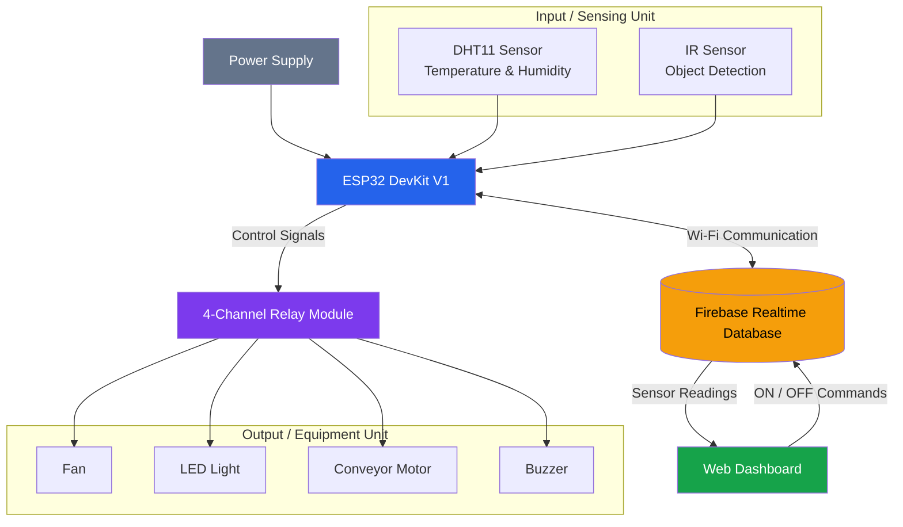
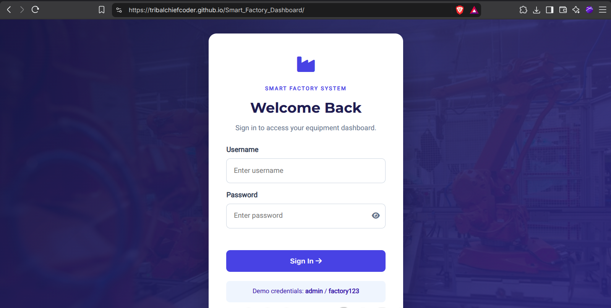
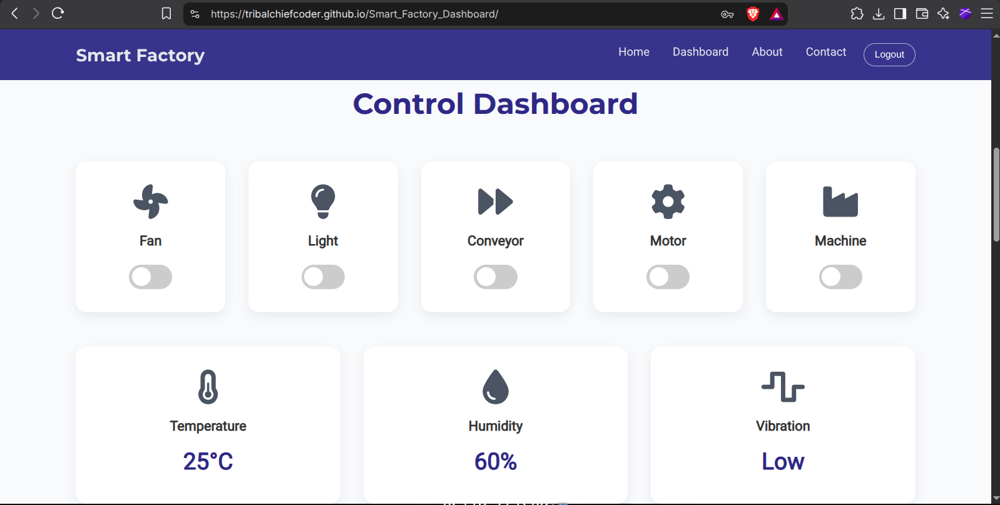
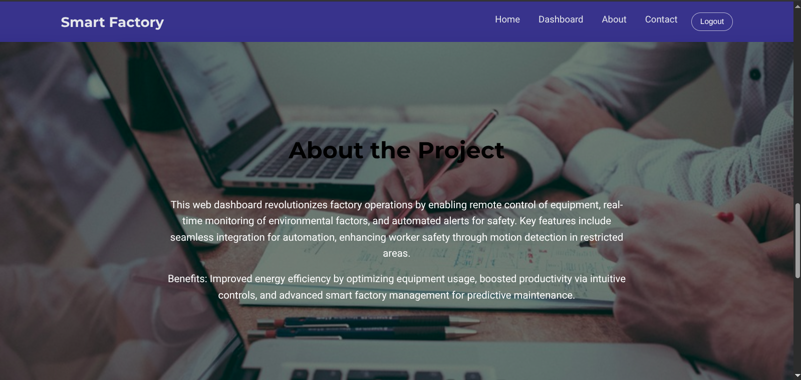
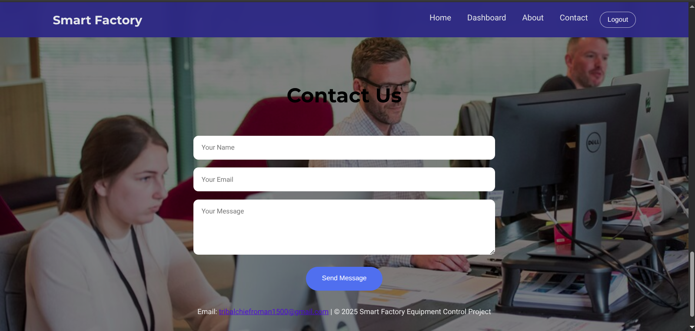

# 🏭 Smart Factory IoT Dashboard with Equipment Control

  **An IoT-Based Industrial Monitoring and Automation System**

  
  
  

---

## 📌 About the Project

**Smart Factory IoT Dashboard with Equipment Control** is a final-year engineering major project developed to demonstrate industrial automation and real-time monitoring using Internet of Things (IoT) technology.

The proposed system uses an **ESP32 microcontroller** to collect environmental and operational data through sensors. The collected information is transmitted over Wi-Fi to **Firebase Realtime Database**, where it can be accessed through a web-based dashboard.

The dashboard provides a centralized interface for monitoring factory conditions and controlling equipment such as fans, lights, conveyor motors, and buzzers through a relay module.

The project aims to reduce manual intervention, improve operational efficiency, enhance monitoring capabilities, and demonstrate the practical implementation of Industry 4.0 concepts.

## 🌐 Live Website

  

**Website:** https://tribalchiefcoder.github.io/Smart_Factory_Dashboard/

The website is deployed using GitHub Pages.

### 🔐 Demo Login Credentials

| Field | Credentials |
|---|---|
| Username | `admin` |
| Password | `factory123` |

> **Note:** The current GitHub Pages deployment provides a frontend demonstration. Equipment notifications are demo notifications and do not confirm physical hardware operation. Live hardware communication requires the ESP32 and Firebase integration to be connected and configured. The frontend-only login is for demonstration purposes and is not secure authentication.

---

## ✨ Key Features

- **Equipment Control:** Interface for switching factory equipment ON and OFF.
- **Temperature Monitoring:** Monitors environmental temperature using DHT11.
- **Humidity Monitoring:** Displays humidity readings from the sensor.
- **Object Detection:** Uses an IR sensor for object detection.
- **Cloud Integration:** Firebase Realtime Database for storing and synchronizing data.
- **Wireless Communication:** ESP32 communicates over Wi-Fi.
- **Centralized Dashboard:** Web interface for monitoring and controlling equipment.
- **Relay-Based Switching:** Controls connected devices through a 4-channel relay module.
- **Alert System:** Buzzer-based alerts for system notifications.
- **User Login:** Login and logout interface for the dashboard demonstration.
- **Contact Form:** EmailJS integration for receiving messages through the website.

---

## 🛠️ Technologies Used

### Software Technologies

| Technology | Purpose |
|---|---|
| HTML5 | Website structure |
| CSS3 | Styling and responsive interface |
| JavaScript | Dashboard functionality |
| Embedded C | ESP32 programming |
| Arduino IDE | Embedded development |
| Firebase Realtime Database | Cloud data storage and synchronization |
| Wokwi | Hardware simulation |
| GitHub Pages | Website hosting |
| EmailJS | Contact form email integration |

### Hardware Components

| Component | Purpose |
|---|---|
| ESP32 DevKit V1 | Main microcontroller |
| DHT11 Sensor | Temperature and humidity monitoring |
| IR Sensor | Object detection |
| 4-Channel Relay Module | Equipment switching |
| DC Motor (60 RPM) | Conveyor mechanism |
| Fan | Cooling demonstration |
| LED Bulb | Lighting demonstration |
| Buzzer | Audio alerts |
| DC Power Supply | Powering the prototype |

---

## ⚙️ System Architecture

The proposed system consists of five major units:

1. **Sensing Unit:** DHT11 and IR sensors collect environmental and operational data.
2. **Processing Unit:** ESP32 processes sensor readings and control commands.
3. **Communication Unit:** Wi-Fi enables communication between ESP32 and Firebase.
4. **Cloud Unit:** Firebase Realtime Database stores and synchronizes system information.
5. **User Interface Unit:** The web dashboard displays sensor readings and provides equipment controls.

### Working Flow Diagram

The system follows two main communication paths:

1. **Monitoring:** Sensors send data to the ESP32, which processes it and uploads it to Firebase. The web dashboard retrieves and displays the sensor readings.
2. **Equipment Control:** Users send ON/OFF commands through the dashboard. These commands are stored in Firebase, retrieved by the ESP32, and executed through the relay module.

## 📸 Project Screenshots

### 1. Login Page

### 2. Dashboard

### 3. About Page

### 4. Contact Us Page

---

## 📚 Research Paper Publication

Our project research paper has been published in the:

**International Research Journal of Modernization in Engineering Technology and Science (IRJMETS)**

### Publication Details

| Particular | Details |
|---|---|
| Paper Title | Smart Factory IoT Dashboard with Equipment Control |
| Journal | International Research Journal of Modernization in Engineering Technology and Science |
| Volume | 08 |
| Issue | 04 |
| Publication Month | April 2026 |
| e-ISSN | 2582-5208 |

### Authors

1. Sumedh Sanjay Varadkar
2. Shubham Rajan Malvankar
3. Shreyash Babaso Patil
4. Sanket Tatyaso Balanna
5. Vinayak D. Chavan

📄 **[Read the Published Research Paper](docs/researchpaper.pdf)**

---

## 📄 Project Documentation

The following documents are part of our final-year project:

| Document | Link |
|---|---|
| Project Report | [View PDF](docs/PROJECT_REPORT.pdf) |
| Published Research Paper | [View PDF](docs/researchpaper.pdf) |
| Project Poster | [View PDF](docs/Poster_Majorproject.pdf) |

---

## 💰 Estimated Project Cost

According to our project report, the estimated prototype cost is:

| Component | Cost |
|---|---:|
| ESP32 | ₹550 |
| DC Motor (60 RPM) | ₹370 |
| 4-Channel Relay Module | ₹200 |
| LED Bulb | ₹80 |
| Conveyor | ₹2,000 |
| DHT11 Sensor | ₹70 |
| IR Sensor | ₹45 |
| Buzzer | ₹60 |
| Fan | ₹250 |
| **Total** | **₹3,625** |

*Prices are based on the project report and may vary.*

---

## 🚀 Future Scope

The project can be further enhanced through:

- Implementation of secure authentication and role-based access.
- Advanced real-time data visualization.
- Historical data logging and analysis.
- Intelligent anomaly detection.
- Predictive maintenance.
- Integration of additional industrial sensors.
- Expansion to larger industrial monitoring environments.

---

## 👨‍💻 Project Team

**Department of Electronics and Telecommunication Engineering**

**Finolex Academy of Management & Technology, Ratnagiri**

**Academic Year: 2025–2026**

| Team Member |
|---|
| Sumedh Sanjay Varadkar |
| Shubham Rajan Malvankar |
| Shreyash Babaso Patil |
| Sanket Tatyaso Balanna |

**Project Guide:** Prof. V. D. Chavan

---

## 🙏 Acknowledgement

We express our sincere gratitude to our project guide, Prof. V. D. Chavan, the Department of Electronics and Telecommunication Engineering, and Finolex Academy of Management & Technology for their valuable guidance, support, and encouragement throughout the development of this project.

---

  **Smart Factory IoT Dashboard with Equipment Control**

  *Building smarter industrial environments through IoT and automation.*

